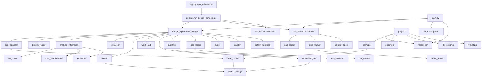

# Dependency Map

**As of:** 2026-10-15. Derived from import statements **and** call sites; an import
alone is not treated as a runtime dependency.

## Production call graph (simplified)

## Cycles

None (checked statically on 2026-10-15 including function-level imports; the
new modules only import "downwards": `design_pipeline → analysis_integration →
grid_manager`, `rebar_detailer → section_design`).

## External libraries

| Library | Used by | Purpose |
|---|---|---|
| numpy | `fea_solver`, `section_design`, `bim_loader` | Linear algebra, vectorised interaction curves |
| pydantic 2 | most models | Data models (`Column`, `StructuralMember`, result models) |
| streamlit | `app.py`, `pages/`, `ui_components`, `ui_state` | UI; `streamlit.testing` in tests |
| ezdxf | `cad_parser`, `dxf_exporter`, tests | DXF read/write |
| segno 1.6.1 (added 2026-10-16) | `site_monitoring` | QR member tags (pure Python, no Pillow) |
| three 0.170.0, esbuild 0.24.0 (npm, build-time only, 2026-10-16) | `components/viewer3d` | 3D viewer bundle; only the built `dist/viewer.js` is needed at runtime (no npm on Streamlit Cloud) |
| reportlab | `report_gen`, `bbs_report` | PDF |
| openpyxl, pandas | `exporters`, pages | Excel, tables |
| plotly, trimesh | `visualizer`, `geometry_exporter` | Views |
| scipy | listed in requirements; no production use found | — |
| ifcopenshell 0.8.4.post1 (in requirements since 2026-10-16) | `bim_loader`, `ifc_exporter`, `tests/ifc_fixture.py` | IFC import/export (manylinux_2_31 wheels for CPython 3.11–3.13 confirmed by pip dry-run) |
| sentry-sdk (optional at runtime) | `monitoring` | Error reporting |

## Duplicate implementations (and how they differ)

| Concern | Production | Alternatives (not production) | Differences |
|---|---|---|---|
| Column capacity | `section_design.check_column` (strain compatibility P-M, biaxial, e_min, slenderness) | `member_design.check_pm_interaction` (balanced-section Mux1 ignoring Pu); `calculations.check_column_capacity`; `audit.audit_columns` (Cl 39.3 form, used only as a consistency screen) | Alternatives give different capacities; see CAL-LEG-01 |
| Beam flexure/shear | `section_design.design_flexure/design_shear` via `rebar_detailer.detail_beam` | `member_design.design_beam`, `calculations.analyze_beam` | `member_design` uses clear cover 40 mm default and SP-16-style fsc bands; production uses the steel stress–strain curve |
| Slab | `rebar_detailer.detail_slab` (Table 26 by case and ratio) | `member_design.design_slab` (ratio 1.0 coefficients only), `slab_generator` | — |
| Base shear | `seismic.SeismicDesignChecker.calculate_base_shear` | `analysis_config.calculate_base_shear` | `analysis_config` has its own spectrum table |
| Combinations | `load_combinations.IS_456_COMBINATIONS` via `analysis_integration.build_combinations` | `analysis_config._generate_load_combinations` | — |
| Quantities | `quantifier`, `wall_calculator` | `quantity_takeoff` | — |
| BBS | `bbs_report.generate_bbs_from_grid_manager` + `bbs_module` | `bbs_utils` (UI utilities) | — |
