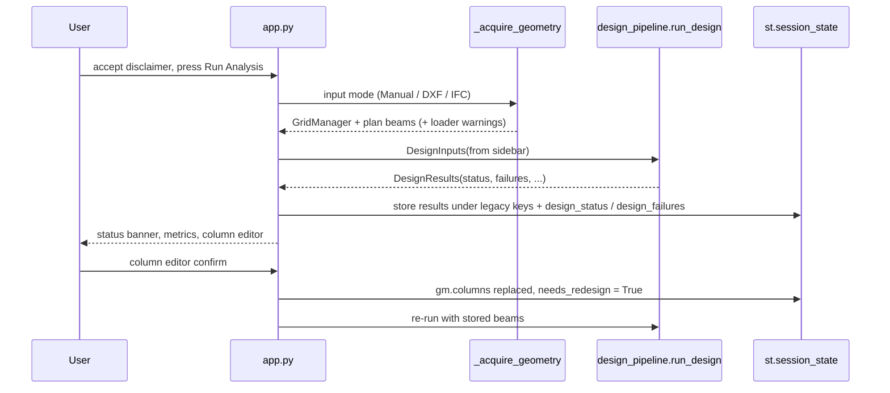

# Execution Flows

**As of:** 2026-10-15. References are `file::symbol`.

## 1. Streamlit dashboard (`app.py`)

- The design runs only when **Run Analysis** is pressed, when no results exist,
  or after a column-editor change (`needs_redesign`). Sidebar changes without
  pressing the button keep the cached results (by design).
- DXF: the uploaded file is written to a temporary file (deleted in `finally`),
  magic bytes are checked first (`app.py::_acquire_geometry`).
- IFC: requires `ifcopenshell`; storeys and storey height come from the IFC.
- Errors in loading or design are logged, sent to Sentry if enabled, shown with
  `st.error` and the script stops (`st.stop()`).

## 2. Design pipeline (`src/design_pipeline.py::run_design`)

1. Occupancy loads (`building_types.get_load_parameters`): floor DL = 25·t + finishes + partitions + services; floor LL; roof DL = 25·t + finishes + services; roof LL.
2. If no beams: `GridManager.generate_beams()` (message added). If no walls: `generate_walls()` (perimeter, optional interior).
3. `boundary_segments` = plan beams (used by slab-panel detection).
4. Tributary areas (staircase bay optional), first takedown, initial column sizing (`optimize_column_sizes`: axial, project minimum 300×450, seismic minimum 300, stack locking).
5. **Iteration** (≤ `max_iterations`, default 6):
   1. takedown (`calculate_loads`, DL/LL split, beam webs, walls, column self-weight, stair allowance);
   2. storey seismic weights → `seismic.run_seismic_check` (Vb, vertical distribution, regularity screening);
   3. wind storey forces (`wind_load.calculate_wind_load`) if a wind zone is given;
   4. `analysis_integration.update_structural_analysis` → envelopes on beams, combination forces on columns;
   5. `detail_beams` (depth grows while FAIL / ρ > 2.5 %), `detail_columns` (all combinations);
   6. failing column stacks grow to the next preferred size; stop when nothing changed.
   If not converged, a final consistent analysis + design pass is run and a message is added.
6. Slabs (`detail_slabs`), staircase (optional), footings (service load + plinth walls; factored = worst level-0 combination + 1.5 × plinth; base moment for an eccentricity warning), footing overlap warnings.
7. Per-level beam copies (`B_x_L{i}`), joint/SCWB/ductility (`seismic.evaluate_joint_checks`), BBS, BOM, masonry, audit, stability, safety warnings.
8. Status aggregation → `DesignResults.status`, `failures`, `messages`.

## 3. CLI (`main.py::main`)

`build_parser` → manual grid or `CADLoader` (+ stacking) → `run_design` → logs
status, every failure, seismic summary, quantities, BlackBox risk prompts →
`ReportGenerator.generate_report(...)` → exit code `1` if status FAIL, `2` on CAD
load error, else `0`. `setup_logging()` writes `structural_design.log` in the
current directory.

## 4. CAD ingest (`cad_loader.py::CADLoader.load_grid_manager`)

1. `CADParser.load` (ezdxf). Columns from LWPOLYLINEs on layers containing COL/PILLAR/STANCHION (declared or used layers).
2. No columns, or `auto_frame=True` → `AutoFramer.identify_structural_nodes` → `ColumnPlacer.generate_placement` → `AutoFramer.generate_beams`.
3. Units: `$INSUNITS` (in, ft, mm, cm, m). If the declared unit gives an extent outside 1–1000 m, or the header is unitless, the size heuristic is used (|coord| > 500 ⇒ mm) and a warning is added.
4. Grid lines from unique column coordinates; columns snapped; beams scaled/snapped.
5. Walls: `extract_walls_normalized` (Tier 1 keyword layers → Tier 2 remaining layers excluding annotation/furniture keywords → Tier 3 all model-space lines), thickness detection, clear height = storey − 0.125 − 0.400 m.
6. Warnings in `CADLoader.load_warnings` (units, Tier-2/3 wall use, missing beams, auto-frame unit assumption) are displayed by `app.py` / logged by `main.py`.

Failure paths: no geometry ⇒ `ValueError` (shown to the user); empty DXF / circles only ⇒ same (verified in the 2026-10 sweep).

## 5. IFC ingest (`bim_loader.py::BIMLoader.load_grid_manager`)

Storeys sorted by elevation; storey height = mean spacing (3.0 m fallback with
warning). Columns: placement origin, extrusion depth, rectangular profile (else
300×300 with warning). Beams: placement × extrusion position × extruded
direction; inclined beams skipped; non-rectangular profiles → 230×450 with
warning; de-duplicated by plan position. Coordinates shifted to min x, y = 0;
grid lines from columns. No IfcColumn ⇒ `ValueError`.

## 6. Reports and exports (pages 3 and 4)

`report_gen.ReportGenerator.generate_report` adds the PRELIMINARY banner and the
design-status table (from `design_status/failures/messages` kwargs) before the
existing sections. Drawings page writes DXF files into the current working
directory on render (behaviour not changed).

## 7. Failure / degraded paths inside analysis

| Situation | Behaviour | Where reported |
|---|---|---|
| Frame unstable / ill-conditioned (cond > 1e12) | Frame skipped; its beams get simply supported factored moments on both faces (`FALLBACK_<status>`) | `AnalysisSummary.failed_frames` → status FAIL; beam WARN |
| Beam not on a grid line | Simply supported fallback (`FALLBACK_NOT_IN_FRAME`) | message, beam WARN |
| Column not on a frame line | Gravity axial + minimum eccentricity only | message |
| Section cannot pass at max size / 4 % steel | Member FAIL with warning | failures list |
| Non-convergence | Last results shown with message | status at least WARN |
| ESA not permitted (irregular, or height limit) | `Seismic method` FAIL | failures list |
