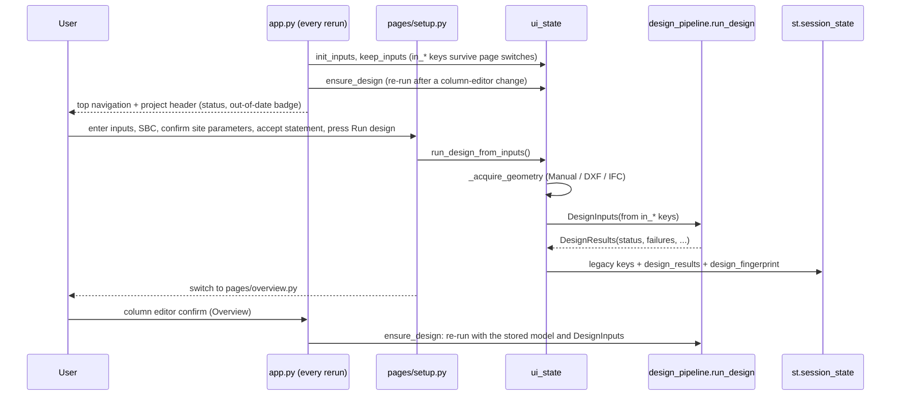

# Execution Flows

**As of:** 2026-10-20. References are `file::symbol`.

## 1. Streamlit app (`app.py` + `pages/`)

- **Run design** is disabled until the SBC is entered (no default), the site-parameter confirmation
  (`in_site_confirmed`) and the verification statement (`in_disclaimer`) are ticked (N18). Changing a site
  parameter, the occupancy or the geometry source clears the site confirmation (`ui_state.on_site_change`).
- `input_fingerprint()` is stored with the results; when the current inputs differ, the header shows
  "Inputs changed — results out of date" and every result page a warning (`ui_state.results_state`). The design
  runs only when **Run design** is pressed or after a column-editor change.
- The status banner reads "PASS for the implemented checks only — NOT VERIFIED" for PASS and is followed by an
  expander listing `DesignResults.checks_not_performed` (N17).
- DXF / IFC: the uploaded bytes are kept in `model_file`, written to a temporary file for loading (deleted in
  `finally`); header bytes are checked first (`ui_state._acquire_geometry`). Fixable input problems raise
  `ui_state.InputError` and are shown as messages.
- IFC: requires `ifcopenshell`; storeys and storey height come from the IFC.
- Errors in loading or design are logged, sent to Sentry if enabled and shown with `st.error`.
- Reports and DXF files are generated when the download button is clicked (callable `data`), not on page load.

## 2. Design pipeline (`src/design_pipeline.py::run_design`)

1. Occupancy loads (`building_types.get_load_parameters`): floor DL = 25·t + finishes + partitions + services; floor LL; roof DL = 25·t + finishes + services; roof LL.
2. If no beams: `GridManager.generate_beams()` (message added). If no walls: `generate_walls()` (perimeter, optional interior).
3. `boundary_segments` = plan beams (used by slab-panel detection).
4. Tributary areas (staircase bay optional), first takedown, initial column sizing (`optimize_column_sizes`: axial, project minimum 300×450, seismic minimum 300, stack locking).
5. **Iteration** (≤ `max_iterations`, default 6):
   1. takedown (`calculate_loads`, DL/LL split, beam webs, walls, column self-weight, stair allowance);
   2. storey seismic weights → `seismic.run_seismic_check` (Vb, vertical distribution, regularity screening);
   3. wind storey forces (`wind_load.calculate_wind_load`) if a wind zone is given;
   4. `analysis_integration.update_structural_analysis` → envelopes on beams, combination forces on columns;
   5. `detail_beams` (depth grows while FAIL / ρ > 2.5 %), `detail_columns` (all combinations);
   6. failing column stacks grow to the next preferred size; if any EQ storey drift exceeds 0.004 h (from the
      analysis just run) **every** column stack grows one preferred size (D-16); stop when nothing changed.
   If not converged, a final consistent analysis + design pass is run and a message is added.
6. Slabs (`detail_slabs`), staircase (optional), footings (service load + plinth walls; factored = worst level-0 combination + 1.5 × plinth; base moment for an eccentricity warning), footing overlap warnings.
7. Per-level beam copies (`B_x_L{i}`), joint/SCWB/ductility (`seismic.evaluate_joint_checks`), BBS, BOM, masonry, audit, stability, safety warnings.
8. Status aggregation → `DesignResults.status`, `failures`, `messages`. Added 2026-10-16: storey-drift rows
   (`drift_checks` → `DesignResults.drift_results`; EQ over limit FAIL, wind top sway over H/500 WARN, missing EQ
   drift WARN), one-direction columns WARN (N19), "Wind not considered" WARN when `wind_zone is None` (N18).
   Footing base moments are un-factored by each combination's own largest factor (N20).

## 3. CLI (`main.py::main`)

`build_parser` → manual grid or `CADLoader` (+ stacking) → `run_design` → logs
status, every failure, seismic summary, quantities, BlackBox risk prompts →
`ReportGenerator.generate_report(...)` → exit code `1` if status FAIL, `2` on CAD
load error, else `0`. `setup_logging()` writes `structural_design.log` in the
current directory.

## 4. CAD ingest (`cad_loader.py::CADLoader.load_grid_manager`)

1. `CADParser.load` (ezdxf). Columns from LWPOLYLINEs on layers containing COL/PILLAR/STANCHION (declared or used layers).
2. No columns, or `auto_frame=True` → `AutoFramer.identify_structural_nodes` → `ColumnPlacer.generate_placement` → `AutoFramer.generate_beams`.
3. Units: `$INSUNITS` (in, ft, mm, cm, m). If the declared unit gives an extent outside 1–1000 m, or the header is unitless, the size heuristic is used (|coord| > 500 ⇒ mm) and a warning is added.
4. Grid lines from unique column coordinates; columns snapped; beams scaled/snapped.
5. Walls: `extract_walls_normalized` (Tier 1 keyword layers → Tier 2 remaining layers excluding annotation/furniture keywords → Tier 3 all model-space lines), thickness detection, clear height = storey − 0.125 − 0.400 m.
6. Warnings in `CADLoader.load_warnings` (units, Tier-2/3 wall use, missing beams, auto-frame unit assumption) are displayed on the Overview (run notes) / logged by `main.py`.

Failure paths: no geometry ⇒ `ValueError` (shown to the user); empty DXF / circles only ⇒ same (verified in the 2026-10 sweep).

## 5. IFC ingest (`bim_loader.py::BIMLoader.load_grid_manager`)

Storeys sorted by elevation; storey height = mean spacing (3.0 m fallback with
warning). Columns: placement origin, extrusion depth, rectangular profile (else
300×300 with warning). Beams: placement × extrusion position × extruded
direction; inclined beams skipped; non-rectangular profiles → 230×450 with
warning; de-duplicated by plan position. Coordinates shifted to min x, y = 0;
grid lines from columns. No IfcColumn ⇒ `ValueError`.

## 6. Reports and exports (pages 3 and 4)

`report_gen.ReportGenerator.generate_report` adds the PRELIMINARY banner and the
design-status table (from `design_status/failures/messages` kwargs) before the
existing sections. Drawings page writes DXF files into the current working
directory on render (behaviour not changed).

## 6a. Site drawing set (Drawings page, first tab)

`pages/drawings.py` builds `src.drawings.build_drawing_set(res.gm, res.beams, res.footings, project)` once per
design result (cached in session state), shows the selected sheet as a pan/zoom SVG, and offers the full PDF set,
the selected sheet as DXF and a ZIP (PDF + DXF + SVG per sheet). Nothing is written to disk. Marks come from
`compute_marks` and are also shown in the Members page tables.

## 6b. 3D viewer (Drawings page, "3D View" tab)

`viewer_model.build_scene(res.gm, res.beams, res.footings)` → JSON boxes (columns per segment, beams and slabs per
floor, walls per storey, footings) with mark, size, bars, status → `viewer_html(scene)` inlines
`components/viewer3d/dist/viewer.js` and the scene → `components.html`. Cached per design result. The older GLB
view (`geometry_exporter`) is behind a checkbox. Nothing is written to disk.

## 6c. Site tools (`pages/site_tools.py`)

BBS tab: `project_bbs` tables and `site_calculators.optimise_cutting` over every BBS entry. Calculators: approved mix
stored in `st.session_state['approved_mix']` (used by the Overview, pour planner and PDF report section 20), cube
register, pour planner, formwork from the model. BIM & Handover: `documentation.calculation_summary(res)`, COBie
from the design, QR tags (`site_monitoring.member_info` → `qr_text` → `qr_png`), inspection checklist CSV and
defect log (`st.session_state['defect_log']`), uploaded accelerometer / strain CSVs, as-built survey CSV.

## 7. Failure / degraded paths inside analysis

| Situation | Behaviour | Where reported |
|---|---|---|
| Frame unstable / ill-conditioned (cond > 1e12) | Frame skipped; its beams get simply supported factored moments on both faces (`FALLBACK_<status>`) | `AnalysisSummary.failed_frames` → status FAIL; beam WARN |
| Beam not on a grid line | Simply supported fallback (`FALLBACK_NOT_IN_FRAME`) | message, beam WARN |
| Column not on a frame line | Gravity axial + minimum eccentricity only | message, column WARN |
| Column on a frame line in one direction only | No frame moments about the other axis | `AnalysisSummary.columns_one_plane` → failures WARN |
| EQ storey drift > 0.004 h | Column stacks grow; FAIL if still exceeded | `drift_results`, failures FAIL |
| Section cannot pass at max size / 4 % steel | Member FAIL with warning | failures list |
| Non-convergence | Last results shown with message | status at least WARN |
| ESA not permitted (irregular, or height limit) | `Seismic method` FAIL | failures list |
